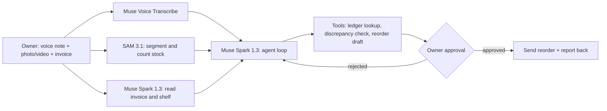

# Hsain Agent

**An AI back-office agent for small retail shops: voice note + shelf photo or video in, verified stock check and approved supplier reorder out.**

Built for the **Meta Global AI Developer Hackathon** (Indie Developer track, *Build for Your World*) with Muse Spark, SAM 3.1 and Muse Voice Transcribe.

> **Demo video (3 min):** `TODO: add link`
> **Live demo:** `TODO: add link or remove`

---

## The problem

Small and medium retail shops in Myanmar run on voice notes, phone photos and handwritten ledgers. Dashboards and accounting software do not fit how owners actually work, so stock errors and late reorders quietly cost them sales and cash. The same gap exists for small retailers across emerging markets.

The author's family runs a retail business in Mandalay, and this project is built from that firsthand experience.

## What it does

1. The owner sends a **voice note** plus a **photo or short video** of a shelf, or a photo of a supplier invoice.
2. The agent **transcribes** the note and **counts and segments** the stock in the media.
3. It **reconciles** the counts against the shop's ledger using tool calls and **flags discrepancies**.
4. It **drafts a supplier reorder** and shows its evidence.
5. The owner **approves in one tap**. Only then is the reorder sent.
6. The agent **reports back** with what was sent and what changed.

The agent never sends anything without owner approval.

## How it works



## Meta models used

| Model | Role in the project |
| --- | --- |
| **Muse Voice Transcribe** (`muse-voice-transcribe-1.0`) | Turns the owner's voice notes into text |
| **SAM 3.1** (`sam-3.1`) | Segments and counts stock in shelf photos and video |
| **Muse Spark 1.3** (`muse-spark-1.3`) | Reads invoices and shelves, reasons over the numbers, and orchestrates the loop with tool calling and structured output |

All calls go through the Meta Model API (`https://api.meta.ai/v1`).

## Verification and approval

- Counts from SAM 3.1 are cross-checked against the ledger and against what the owner said in the voice note.
- Mismatches are surfaced with the supporting image or clip, not silently corrected.
- Every outgoing action requires explicit owner approval, and the audit trail is stored.

## Built during the hackathon

All code in this repository was written between **Oct 27 and Nov 4, 2026**, starting from an empty repo. No code from earlier projects is included. The commit history shows the timeline.

- Third-party libraries and frameworks are listed in `package.json` and `requirements.txt`.
- All demo data (shelves, invoices, ledgers) is **synthetic or anonymized**. No real customer or business records are in this repo.

## Tech stack

`TODO: confirm and edit`

- Web app (mobile-friendly): Next.js + TypeScript
- Agent service and tools: Python + FastAPI
- Ledger store: SQLite
- AI: Meta Model API (OpenAI-compatible SDK)

## Getting started

Prerequisites: Node.js 18+, Python 3.9+, and a Meta Model API key from the [Model API dashboard](https://dev.meta.ai/).

```bash
git clone https://github.com/<your-username>/hsain-agent.git
cd hsain-agent

cp .env.example .env        # then set MODEL_API_KEY

# backend
pip install -r requirements.txt
uvicorn app.main:app --reload

# frontend
npm install
npm run dev
```

`TODO: adjust commands to match the final project layout`

### Environment variables

| Variable | Description |
| --- | --- |
| `MODEL_API_KEY` | Your Meta Model API key |
| `MODEL_API_BASE` | `https://api.meta.ai/v1` |

## Project status

- [ ] Voice note transcription
- [ ] Stock segmentation and counting from photo or video
- [ ] Invoice reading and ledger reconciliation
- [ ] Discrepancy flagging with evidence
- [ ] Reorder draft and one-tap approval
- [ ] Report-back and audit trail
- [ ] Burmese voice and text tested (`TODO: record results here`)

## Known limitations

- Stock counts are estimates and depend on image quality and lighting.
- Language support depends on what the Meta models support. Results for Burmese are recorded in the status list above.
- This is a hackathon prototype, not production software.

## License

MIT. See [LICENSE](LICENSE).

## Author

**Shwe Win Aung (Nikki)**, freelance full-stack and GenAI developer, Mandalay, Myanmar.
